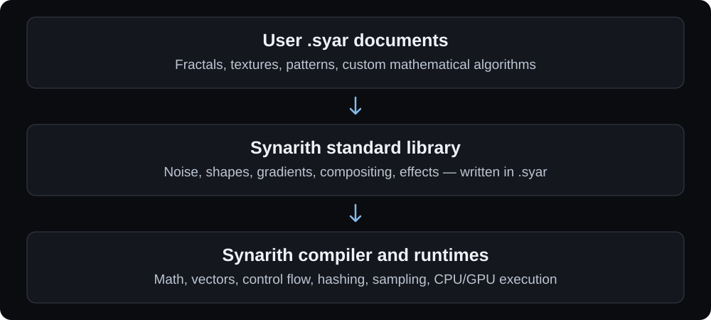

# Synarith


**Images synthesized through arithmetic.** Synarith is a Rust 2024 procedural image toolkit with parallel CPU and GPU renderers, a Rust library, a command-line application, and an cross-platform egui viewer.

A `.syar` document describes mathematical fields and algorithms. Render the same composition as a thumbnail, a large print, or an animation frame without storing a raster source. Sampling quality, numeric precision, and available resources still impose practical limits.

```text
syar 1;
use std;
param speed: float = 0.2;
param scale: float = 6.0;
let position = p * scale + vec2(t * speed, 0.0);
let clouds = fbm(position, octaves: 6);
output main = mix(srgb("#13254b"), srgb("#f4c879"), clouds);
```

## Run

Install a current stable Rust toolchain and a native C/C++ linker. Windows uses the MSVC build tools; macOS uses the Xcode command-line tools. GPU rendering uses native graphics drivers through wgpu. CPU rendering requires no graphics driver or window system.

```sh
cargo build --release --locked
cargo run -p synarith-cli --release -- validate examples/tiles.syar
cargo run -p synarith-cli --release -- render examples/paths.syar -o picture.png --width 2048 --height 2048 --samples 2
cargo run -p synarith-cli --release -- animate examples/orbit.syar -o frames --frames 120 --fps 30 --width 512 --height 512
```

The CLI executable is `syar` (`syar.exe` on Windows). Run `syar --help` or a subcommand's `--help` for options. Still exports support PNG, JPEG, BMP, TGA, and PPM, inferred from the filename or selected with `--format`; existing files require `--force`. JPEG quality uses `--quality 1..100` (default 90). PNG/BMP/TGA retain alpha; JPEG/PPM composite over white. Animation writes PNG frames at `start + frame/fps`; 120 frames at 30 fps cover `[0,4)` seconds.

The CLI defaults to `--backend auto`: it uses the GPU when available and reports a reason when falling back to the parallel CPU renderer. Use `--backend gpu` to require GPU execution or `--backend cpu` for CPU rendering. Explicit GPU failures return an error.

GPU support is enabled by default. For a smaller CPU-only executable with no graphics dependencies:

```sh
cargo build -p synarith-cli --release --no-default-features --locked
```

This build still accepts `auto` (with a visible CPU fallback) and rejects `gpu`. Plain `cargo build` builds both `syar` and `syar-view`. For a CLI-only build with GPU support, use `cargo build -p synarith-cli --release --locked`; selecting the CLI or library package excludes viewer dependencies.

## Live viewer

```sh
cargo build -p synarith-viewer --release --locked
target/release/syar-view examples/koch-snowflake.syar
target/release/syar-view examples/mandelbrot.syar --paused
```

The viewer uses egui/eframe on Windows, Linux, and macOS. It renders directly through the Rust library on a persistent background worker, reusing compiled CPU/GPU programs. Open a `.syar` file or drop one onto the window. Playback starts at `t = 0` and advances continuously without an imposed loop endpoint; the document decides how its image evolves. Pause for a still, restart, seek to a time, or change playback speed. File changes reload automatically; invalid source retains the last valid document and preview. The source panel is read-only; edit the file in your preferred editor.

Scroll or pinch to zoom smoothly at the cursor, drag to pan, and double-click or press `0` to fit the composition. Zoom resamples the mathematical field instead of enlarging a saved bitmap. The camera has no fixed magnification cap. Normal views use the GPU/f32 path; `auto` selects f64 CPU arithmetic when f32 rounding would lose pixel detail, preserving the cached GPU pipeline for zooming back out. Intermediate arithmetic, loops, and transformed sampling then use f64; compiled literals and parameters retain their f32 representation. Required `gpu` mode reports a clear error at that transition. Export checks precision at its own resolution and sampling quality.

While navigating, the latest preview follows the camera immediately, with bounded adaptive rendering in the background and full selected quality after settling. Zoom does not grow image buffers or unroll algorithms. This extends useful magnification substantially, but does not promise literal infinite precision or new detail beyond the document's own algorithms: navigation stops at the f64 representability boundary.

Choose named outputs, edit typed parameters, switch `auto`/`cpu`/`gpu`, and adjust preview quality. Playback adapts resolution to render cost and keeps one pending frame; pausing renders at the selected quality. Obsolete work is cancelled and stale results discarded. The viewer contains no algorithm-specific buttons or embedded examples; open any normal `.syar` document. Keyboard shortcuts: `Space` plays/pauses, `R` restarts, `O` opens, and `E` exports.

Still export uses the current time and camera, selected resolution, samples per axis, PNG/JPEG/BMP/TGA/PPM format, and JPEG quality. Existing files are protected; choose a new filename. Different export aspect ratios preserve the current camera rectangle with transparent padding. Rendering and export stay off the interface thread and can be cancelled. The viewer runs independently of the CLI executable.

The egui interface uses OpenGL through eframe; procedural rendering uses wgpu or the CPU. Windows builds need MSVC and the Windows SDK; macOS needs the Xcode command-line tools. Linux supports X11 and Wayland and needs OpenGL/EGL drivers, xkbcommon, and a desktop file portal for native dialogs. For Debian/Ubuntu builds, install `build-essential pkg-config libx11-dev libxi-dev libxcursor-dev libxrandr-dev libxkbcommon-dev libwayland-dev libgl1-mesa-dev libegl1-mesa-dev`. Native dialogs use the operating system on Windows/macOS and the XDG desktop portal on Linux. No Qt installation is required. Selecting only the CLI or library package excludes egui and window-system dependencies.

## Architecture



User documents and the standard library compile through the same typed graph and structured function representation. `synarith-stdlib` is a dependency-free source crate; `synarith-core` parses, resolves, checks limits, and builds shared execution schedules. CPU and GPU backends implement only the small mathematical core. Algorithms can be copied, edited, or expanded into a standalone document without changing either renderer.

Compilation schedules each expression in dependency order, keeps sampling contexts separate, and includes only functions reachable from the selected output. Branches and bounded loops stay structured. CPU execution reuses registers for expressions with substantial shared work, with a direct path for small trees; GPU code uses explicit temporaries before native shader compilation. `Renderer` caches prepared CPU schedules and GPU pipelines across tiles, frames, and parameter overrides. CPU execution is an interpreter, with no JIT dependency.

## Author documents

Write `.syar` text files with named fields, typed parameters, reusable groups, mathematical functions, and time expressions. Functions support mutable local variables, `if`/`else`, bounded `for`/`while` loops, `break`, `continue`, and early returns. Only math, vectors, colors, basic compositing, deterministic hashing, and field sampling are built into the renderer. Noise algorithms, shapes, paths, transforms, and effects are ordinary `.syar` functions/groups in the [source standard library](crates/stdlib/src/standard.syar), explicitly enabled with `use std;`. Mandelbrot, Julia, and the Barnsley fern are defined in their example documents. CPU and GPU execute the same algorithms with deterministic sample-local state.

```text
fn julia(q: vec2, c: vec2) -> float {
    var z = q;
    for i in 0..128 {
        z = vec2(x(z)*x(z) - y(z)*y(z), 2.0*x(z)*y(z)) + c;
        if dot(z,z) > 256.0 { return float(i) / 128.0; }
    }
    return 1.0;
}
```

| Layer | Implemented by |
| --- | --- |
| Math, vectors, color construction/interpolation, alpha compositing | Core operations |
| Deterministic lattice hash, coordinate sampling, sampling footprints | Core operations |
| Value/gradient/cellular noise, fBm, turbulence, ridged noise | `.syar` library algorithms |
| Circles, rectangles, polygons, stars, Bézier paths, gradients | `.syar` library algorithms |
| Blur, normals, distortion, patterns, glows, blend modes | `.syar` library algorithms |
| Mandelbrot, Julia, Barnsley fern, nebula integration | Functions in example documents |

The library is bundled as source and uses the same compiler as your own code. No filesystem lookup or external import is needed. Function/group arguments can have typed constant defaults, such as `radius: float = 0.3`. To embed only the required helper definitions in a document, run:

```sh
syar fmt picture.syar --expand-std --write
```

The resulting file contains ordinary functions/groups and no `use std;` directive. This makes the algorithm implementations explicit for archiving, editing, or another renderer. `sample_at(source, coordinates)`, `footprint(source)`, and `pixel_size()` let you write your own filters and antialiasing; groups retain field expressions for resampling, while function arguments are evaluated values.

Loops have compile-time bounds up to 4096 and a checked evaluation budget; `while` requires an explicit `limit`. There is no recursion, shared frame state, or external I/O. Start with the [custom Julia algorithm](examples/algorithms.syar), use `syar validate` for source-position diagnostics, and inspect built-ins with `syar inspect --operations`. The generated format guide documents full function syntax and sampling behavior.

The [Halcyon Reach space wallpaper](examples/deep-space.syar) uses custom iterative filaments and front-to-back nebula integration, with a ringed gas giant, star fields, atmospheric glow, and a 24-second animation loop. The document is entirely procedural:

```sh
syar render examples/deep-space.syar -o space.png --width 3840 --height 2160 --samples 2
syar animate examples/deep-space.syar -o space-frames --frames 240 --fps 10 --width 1920 --height 1080
```

The [Mandelbrot example](examples/mandelbrot.syar) defines its own `mandelbrot()` function from arithmetic, a bounded loop, and logarithms. It retains smooth escape coloring, center, zoom, iterations, and a ten-second palette loop. Copy its function into another document to reuse it; there is no implicit Mandelbrot operation:

```sh
syar render examples/mandelbrot.syar -o mandelbrot.png --width 1400 --height 1000 --samples 2
syar render examples/mandelbrot.syar -o detail.png --param 'center=vec2(-0.75,0.1)' --param zoom=12.0 --param iterations=512
```

The [Barnsley fern](examples/barnsley-fern.syar) implements the classic [four-map iterated function system](https://paulbourke.net/fractals/ifs/index.html) using a deterministic chaos game. Each sample evaluates distance to the same finite orbit, with no stored point cloud or raster. Adjust `points` (21–12288, default 8192), `orbit_seed`, `thickness` in document units, and `leaf`/`tip`/`paper` colors. More points fill in finer fronds; `--output-name fern` exports a transparent cutout. GPU rendering is useful for this computation-heavy example.

```sh
syar render examples/barnsley-fern.syar -o fern.png --width 1000 --height 1750 --backend gpu
syar render examples/barnsley-fern.syar -o fern-cutout.png --width 1000 --height 1750 --output-name fern --param points=12288
```

The [Koch snowflake](examples/koch-snowflake.syar) and [Heighway dragon curve](examples/dragon-curve.syar) implement their segment construction and distance-based drawing entirely in `.syar`. Their `main` outputs draw progressively from time zero; select `still` for the complete curve. Change `draw_seconds` to control reveal duration. Finite generation limits bound work per pixel: Koch `depth` is clamped to 0–4 and Dragon to 0–10.

```sh
syar render examples/koch-snowflake.syar -o koch.png --output-name still --width 1200 --height 1140 --samples 2
syar render examples/dragon-curve.syar -o dragon.png --output-name still --width 1400 --height 1040 --samples 2
```

## Documentation

The API reference, format guide, CLI manual, and examples live in Rust doc comments beside the code. Generate the searchable HTML reference with:

```sh
cargo doc --workspace --no-deps --open
```

The library entry point is `target/doc/synarith/index.html`, including the `format` guide and `cli` manual. Each public type, field, operation, and method is documented; examples are checked by `cargo test`. Missing public documentation and rustdoc warnings fail CI.

The `synarith` crate provides parsing, compilation, parameter overrides, CPU/GPU rendering, cancellation, and PNG export. `Renderer::new(program)` uses CPU rendering; `Renderer::with_backend(program, Backend::Auto)` enables automatic backend selection. Set `default-features = false` on the library dependency to omit GPU support.

CI artifacts include the generated reference at `target/doc/synarith/index.html` and the executables under `target/release/`.

## Verification

```sh
cargo test --workspace --locked
cargo doc --workspace --no-deps --locked
cargo bench -p synarith --bench render
```

Tests execute all registered operations and bundled examples on CPU and compare actual GPU execution where available. Set `SYAR_REQUIRE_GPU=1` to fail instead of skipping when no adapter exists. CI builds and packages Windows, Linux, and macOS, and includes a required Vulkan execution job on Linux.

The benchmark reports preparation time, paired serial point-evaluation times for the recursive reference and prepared CPU paths, and median parallel render times after warmup. Cases cover noise, paths, warps, and a shared iterative algorithm. Sharing can remove repeated computation; small trees use a direct path, and timings depend on the document and machine. GPU tests allow a maximum absolute difference of 0.004 per linear RGBA component in representative cases. Windows tests have executed on an NVIDIA GeForce RTX 5090 through Vulkan; Linux/macOS verification runs in CI.

The initial implementation deliberately excludes raster imports, external executable code, recursion, external includes, web delivery, keyframe tracks, audio, and video encoders. Ellipse distance is an approximation, `bezier` uses 64 segments, and `path` has a bounded tolerance-based tessellation. These source-library algorithms describe continuous fields within practical finite precision.

Licensed under MIT OR Apache-2.0.
