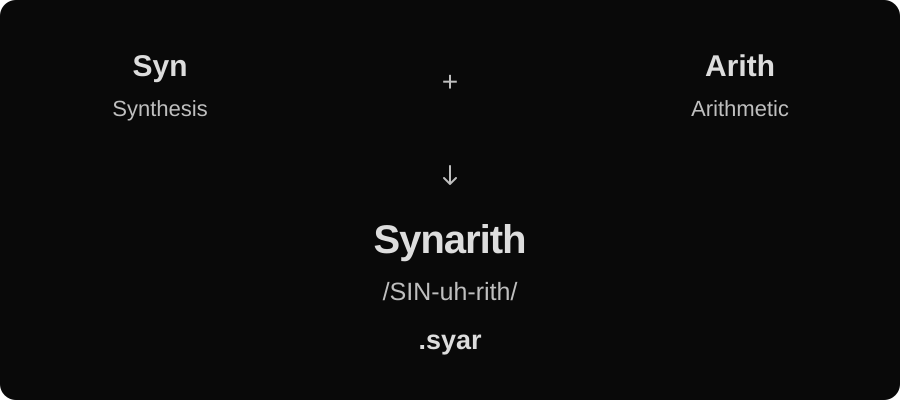

# Synarith



**Images synthesized through arithmetic.** Synarith is a Rust 2024 procedural image toolkit with parallel CPU and GPU renderers, a Rust library, a command-line application, and an optional lightweight native viewer.

A `.syar` document describes mathematical fields rather than pixels. Render the same composition as a thumbnail, a large print, or an animation frame without storing a raster source. Sampling quality, numeric precision, and available resources still impose practical limits.

```text
syar 1;
param speed: float = 0.2;
param scale: float = 6.0;
let position = p * scale + vec2(t * speed, 0.0);
let clouds = fbm(position, octaves: 6);
output main = mix(srgb("#13254b"), srgb("#f4c879"), clouds);
```

## Run

Install a current stable Rust toolchain and a native C/C++ linker. Windows uses the MSVC build tools; macOS uses the Xcode command-line tools. GPU rendering uses native graphics drivers through wgpu. CPU rendering requires no graphics driver or window system.

```sh
cargo build --release --locked
cargo run -p synarith-cli --release -- validate examples/tiles.syar
cargo run -p synarith-cli --release -- render examples/paths.syar -o picture.png --width 2048 --height 2048 --samples 2
cargo run -p synarith-cli --release -- animate examples/orbit.syar -o frames --frames 120 --fps 30 --width 512 --height 512
```

The CLI executable is `syar` (`syar.exe` on Windows). Run `syar --help` or a subcommand's `--help` for options. Still exports support PNG, JPEG, BMP, TGA, and PPM, inferred from the filename or selected with `--format`; existing files require `--force`. JPEG quality uses `--quality 1..100` (default 90). PNG/BMP/TGA retain alpha; JPEG/PPM composite over white. Animation writes PNG frames at `start + frame/fps`; 120 frames at 30 fps cover `[0,4)` seconds.

The CLI defaults to `--backend auto`: it uses the GPU when available and reports a reason when falling back to the parallel CPU renderer. Use `--backend gpu` to require GPU execution or `--backend cpu` for CPU rendering. Explicit GPU failures return an error.

GPU support is enabled by default. For a smaller CPU-only executable with no graphics dependencies:

```sh
cargo build -p synarith-cli --release --no-default-features --locked
```

This build still accepts `auto` (with a visible CPU fallback) and rejects `gpu`. Plain `cargo build` builds both `syar` and `syar-view`. For a CLI-only build with GPU support, use `cargo build -p synarith-cli --release --locked`; selecting the CLI or library package excludes viewer dependencies.

## Small native viewer

```sh
cargo build -p synarith-cli -p synarith-viewer --release --locked
target/release/syar-view examples/mandelbrot.syar
```

Keep `syar-view` beside `syar`, or locate the CLI with `--cli PATH` or `PATH`. The standalone viewer needs no Python, browser, or GPU framework. It opens `.syar` files, displays bounded PNG previews, and delegates every render/export to the CLI. Choose export dimensions, PNG/JPEG/BMP/TGA/PPM, JPEG quality, sampling, backend, time, output name, and semicolon-separated parameter overrides. Previews are capped at 768 pixels per axis; export uses the full requested dimensions. Rendering can be cancelled, and errors retain the previous preview.

Controls and file dialogs use Win32 on Windows, AppKit on macOS, and Qt6 Widgets on Linux. Text editing, clipboard, keyboard navigation, and widget appearance come from those toolkits. No font is bundled, and the viewer adds no authoring canvas or document editor.

Linux requires a C++17 compiler, `pkg-config`, and a system Qt6 installation. On Debian/Ubuntu, install `g++ pkg-config qt6-base-dev`; at runtime the system Qt6 Widgets libraries and a suitable Qt platform plugin must be installed (for example `libqt6widgets6 qt6-qpa-plugins`). Qt6 is dynamically linked: static Qt is rejected, and no Qt libraries or plugins are bundled. Windows builds require the MSVC C++ tools and Windows SDK, and releases use the Microsoft Visual C++ runtime. macOS requires the Xcode command-line tools to build. These GUI build requirements do not apply to CLI/library builds.

## Author documents

Write `.syar` text files with named fields, typed parameters, reusable groups, and time expressions. Start with the bundled examples, use `syar validate` for source-position diagnostics, and inspect available operations with `syar inspect --operations`. Render stills or frame sequences through the CLI or library.

The [Mandelbrot example](examples/mandelbrot.syar) exposes center, zoom, iterations, and a ten-second palette loop:

```sh
syar render examples/mandelbrot.syar -o mandelbrot.png --width 1400 --height 1000 --samples 2
syar render examples/mandelbrot.syar -o detail.png --param 'center=vec2(-0.75,0.1)' --param zoom=12.0 --param iterations=512
```

## Documentation

The API reference, format guide, CLI manual, and examples live in Rust doc comments beside the code. Generate the searchable HTML reference with:

```sh
cargo doc --workspace --no-deps --open
```

The library entry point is `target/doc/synarith/index.html`, including the `format` guide and `cli` manual. Each public type, field, operation, and method is documented; examples are checked by `cargo test`. Missing public documentation and rustdoc warnings fail CI.

The `synarith` crate provides parsing, compilation, parameter overrides, CPU/GPU rendering, cancellation, and PNG export. `Renderer::new(program)` uses CPU rendering; `Renderer::with_backend(program, Backend::Auto)` enables automatic backend selection. Set `default-features = false` on the library dependency to omit GPU support.

CI artifacts include the generated reference at `target/doc/synarith/index.html` and the executables under `target/release/`.

## Verification

```sh
cargo test --workspace --locked
cargo doc --workspace --no-deps --locked
cargo bench -p synarith --bench render
```

Tests execute all registered operations and bundled examples on CPU and compare actual GPU execution where available. Set `SYAR_REQUIRE_GPU=1` to fail instead of skipping when no adapter exists. CI builds and packages Windows, Linux, and macOS, and includes a required Vulkan execution job on Linux.

The benchmark reports median CPU render times for noise-heavy, path-heavy, and warp-heavy 128×128 documents after warmup. GPU tests allow a maximum absolute difference of 0.004 per linear RGBA component in representative cases. Windows tests have executed on an NVIDIA GeForce RTX 5090 through Vulkan; Linux/macOS verification runs in CI.

The initial implementation deliberately excludes raster imports, arbitrary executable code, recursion, external includes, web delivery, keyframe tracks, audio, and video encoders. Ellipse distance is an approximation, `bezier` uses 64 segments, and `path` has a bounded tolerance-based tessellation. These are continuous procedural operations, but are not claims of exact arbitrary-precision geometry.

Licensed under MIT OR Apache-2.0.
